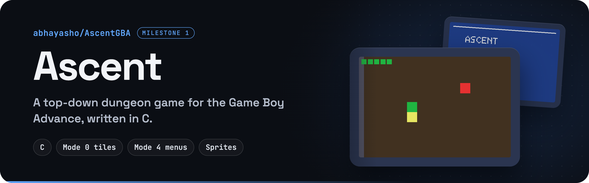
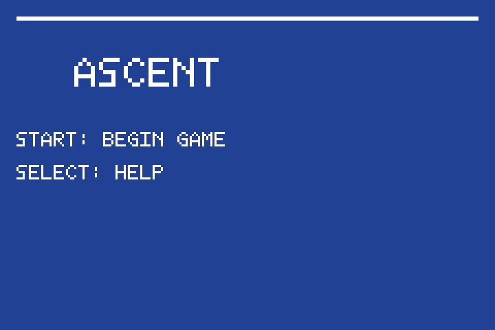
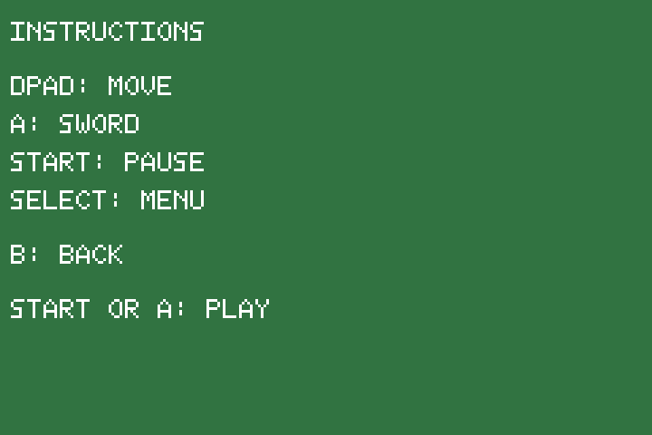
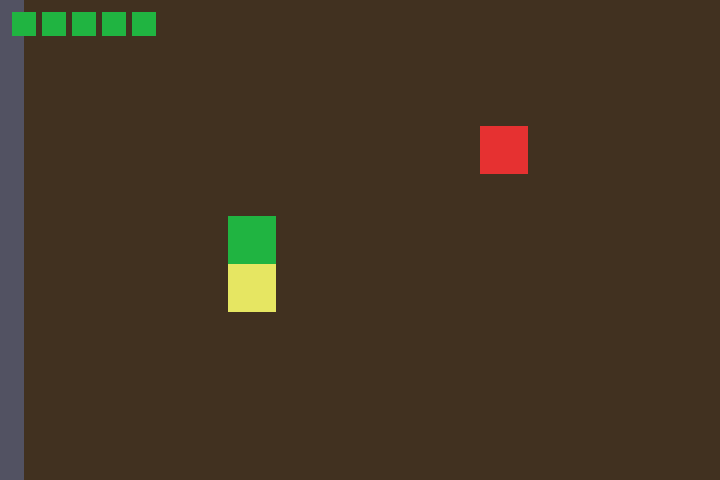
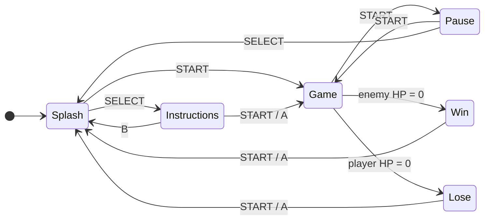

  

  
  
  

# Ascent: Milestone 01

**Student:** Ashok Abhay

**Ascent** is a top-down dungeon game for the Game Boy Advance, written in C. This milestone sets up the full state machine, the Mode 4 menu screens, a scrolling Mode 0 dungeon spread over three connected rooms, sprites, and basic sword combat. The art is placeholder squares for now.

<table>
  <tr>
    <td align="center"> Splash (Mode 4)</td>
    <td align="center"> Instructions (Mode 4)</td>
    <td align="center"> Dungeon, sword swing (Mode 0)</td>
  </tr>
</table>

Frames drawn by the game's own C code at 240×160, scaled up 3×. The art is placeholder squares, as the course guidance allows for M01.

## What is finished

- **State machine** with every required state: START (splash), INSTRUCTIONS, GAME (Mode 0 tiled map), PAUSE, WIN and LOSE. You can reach each one with the buttons below.
- **Mode 4 menu screens:** text labels on colored backgrounds, with BG2 enabled so the screen isn't blank.
- **Mode 0 gameplay:** a scrolling tilemap with three connected rooms in a row (east doors: room 0 → 1 → 2). Room 2 uses a darker floor tile. The grunt enemy only appears in room 0.
- **Sprites:** player (green square), enemy (red square), sword swing (yellow square) and HP pips in the top-left corner.
- **Combat:** A swings the sword with a short hitbox, and the enemy has HP. Touching the enemy damages the player, followed by brief invincibility.
- **Win / lose:** WIN when the enemy's HP reaches 0, LOSE when the player's HP reaches 0.

## What still needs to be added

- Real art and animation, tower progression, bosses, abilities, audio, two independent backgrounds / parallax, runtime tile and palette effects, a cheat, and polished HUD text.
- I don't think I'll do the XP system anymore. I'll keep the ability system with one equipped ability instead of two, to keep the project manageable.
- Dialogue will be done last; I still need to think it through.

## Known issues

- Graphics are intentionally placeholder squares for M01, per course guidance.
- Enemy behavior is basic for now: getting close to the enemy hurts you, but it doesn't swing, move around or shoot yet. That's planned for the next milestone.

## How to build

Use the run tasks method: run the build task (or, from the project directory, the provided build command). The build produces a `.gba` file in this folder, which you can open in an emulator such as [mGBA](https://mgba.io).

## How to play and see each state

### Title / splash (dark blue)

| Button | Action |
| --- | --- |
| START | Start a new game (full reset) |
| SELECT | Open Instructions |

### Instructions (green)

| Button | Action |
| --- | --- |
| START or A | Begin game |
| B | Back to splash |

### Game (dungeon)

| Button | Action |
| --- | --- |
| D-Pad | Move |
| A | Sword attack |
| START | Pause (doesn't reset the run) |

### Pause (gray)

| Button | Action |
| --- | --- |
| START | Resume the same run |
| SELECT | Quit to splash (resets the session) |

### Win (yellow) / Lose (red)

| Button | Action |
| --- | --- |
| START or A | Return to splash |

### Rooms

- **Room 0:** the enemy is here. Use the east door (right side, vertical gap) to enter room 1.
- **Room 1:** the middle room. West goes back to 0, east goes to room 2.
- **Room 2:** darker floor. West returns to room 1.

## Project files

| File | What's inside |
| --- | --- |
| `main.c` | State machine and main loop |
| `menu_ui.c` / `menu_font.inc` | Mode 4 menu screens and font |
| `mode0.c` | Tilemap, rooms, camera scrolling and gameplay |
| `mode4.c` | Mode 4 drawing and page flipping |
| `sprites.c` | OAM helpers for the sprites |
| `gba.c` / `analogSound.c` / `print.c` | Hardware helpers, sound and mGBA debug logging |
| `M01.pdf` | Milestone 01 document |
