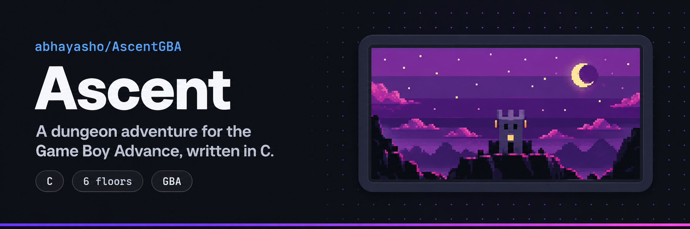
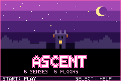
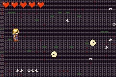

<p align="center">
  
</p>

<p align="center">
  
  
  
</p>

**Student:** Ashok Abhay

**Project:** CS 2261 final submission

Explore a branching dungeon, defeat enemies, collect XP, and upgrade your character as you ascend through six floors: **Sight, Sound, Taste, Smell, Touch, and Soul**. Each floor has its own room connections, boss behavior, and difficulty scaling.

<table>
  <tr>
    <td align="center"><br><sub>Title screen (Mode 4)</sub></td>
    <td align="center"><br><sub>Dungeon gameplay (Mode 0)</sub></td>
  </tr>
</table>

<sub>Actual frames captured from the included final ROM in mGBA at the GBA's native 240×160 resolution. The banner is promotional artwork inspired by the title screen.</sub>

This repository contains the final project from `CSGBA/FINAL_AshokAbhay`. The original Milestone 01 documentation and screenshots are preserved in [development history](docs/milestone-01/README.md).

## Play

Download [the included final ROM](my_project.gba) and open it in a Game Boy Advance emulator such as [mGBA](https://mgba.io). The ROM is the existing compiled submission supplied with the project.

Start a run from the title screen, explore connected rooms, and defeat each floor's boss to advance. Stand in a healing pool to recover health. Strike a skill totem with your sword to open the upgrade menu, where XP can be exchanged for skill points and spent on **STR**, **CON**, and **MOB**.

## Features

- **Six-floor progression:** branching rooms, transitions, floor-complete screens, and a final win state.
- **Sword combat:** directional attacks, hit feedback, knockback, damage, and temporary invincibility after getting hurt.
- **Enemy variety:** patrol slimes, shooter plants, bruisers, and bosses with floor-specific attack patterns.
- **Character growth:** XP orb drops, skill points, stat upgrades, skill totems, and healing pools.
- **HUD:** heart-based health, XP progress, skill points, and a boss health bar.
- **GBA graphics:** Mode 0 tiled gameplay, two backgrounds with parallax scrolling, animated sprites, runtime palette changes, and runtime tile changes.
- **Menus:** Mode 4 title, instructions, pause, skill, floor-complete, win, and lose screens with custom palettes, gradients, sparkles, and shadowed text.
- **Audio:** looping background sound alongside effects for attacks, hits, XP pickups, healing, upgrades, boss events, and game outcomes.
- **Easy mode:** a title-screen cheat that grants starting XP and a skill point, increases sword damage, and extends invincibility after damage.

## Controls

These are GBA buttons; keyboard mappings depend on your emulator.

| Screen | Button | Action |
| --- | --- | --- |
| Title | START | Start a new run |
| Title | SELECT | Open instructions |
| Title | Hold SELECT + tap B | Toggle easy mode before starting |
| Instructions | A / START | Start a new run |
| Instructions | B | Return to title |
| Gameplay | D-Pad | Move |
| Gameplay | A | Swing sword; strike a totem to open upgrades |
| Gameplay | START | Pause |
| Skill menu | Up / Down | Move selection |
| Skill menu | A | Buy the selected upgrade / exchange XP / confirm Save |
| Skill menu | SELECT | Apply upgrades and return to gameplay |
| Skill menu | B | Discard menu changes and return |
| Pause | START | Resume |
| Pause | SELECT | Reset and return to title |
| Floor complete | A / START | Continue to the next floor |
| Win / Lose | A / START | Return to title |

The skill menu's Save action applies upgrades to the current run; it does not write a persistent game save.

## Build from source

The supplied [VS Code tasks](.vscode/tasks.json) use Docker and the `aaaronic/gba-compiler:1.4` image.

1. Install Docker and start its engine.
2. Open the project folder in VS Code and run **Tasks: Run Task → build**, or run this command from the project root:

   ```sh
   docker run --rm -it -v "$PWD:/gba" aaaronic/gba-compiler:1.4
   ```

3. Open the resulting `my_project.gba` in your emulator. On macOS, the **run** task builds and launches `/Applications/mGBA.app`; adjust the emulator path in the task if needed. The Windows run task also needs your local mGBA path.

To remove build outputs with the supplied compiler image:

```sh
docker run --rm -it -v "$PWD:/gba" aaaronic/gba-compiler:1.4 clean
```

The repository includes the submitted ROM for immediate play. Compiler intermediates and emulator save files are excluded from Git.

## Project structure

| Files | Purpose |
| --- | --- |
| `main.c` | Application state machine and screen transitions |
| `mode0.c` / `mode0.h` | Rooms, combat, enemies, bosses, progression, HUD, and gameplay rendering |
| `menu_ui.c` / `menu_ui.h` / `menu_font.inc` | Menu layouts, effects, and font |
| `player_frames.*` / `enemy_frames.*` / `boss_frames.*` | Sprite frame data |
| `heart_sprite_data.c` / `Assets/` | Heart graphics, sprite source assets, and asset notes |
| `digitalSound.*` / `analogSound.*` | Digital audio playback and hardware sound effects |
| `gba.*` / `mode4.*` / `sprites.*` / `print.*` | GBA hardware, drawing, OAM, and debug helpers |
| `.vscode/tasks.json` | Build, run, clean, audio, and packaging tasks |
| `my_project.gba` | Playable final submission ROM |
| `docs/milestone-01/` | Original milestone document, README, and early screenshots |

## Known limitations

- Hitboxes can be finicky in tight spaces.
- Boss patterns, enemy pacing, and some stats may still benefit from balancing.

## Asset credits

The source assets include graphics labeled from *Sword of Mana*, *Mario Party Advance*, *Spy Kids 3-D: Game Over*, and *Angelique*. These remain third-party assets used in a student project.

Pixel heart art is by **Nicole Marie T** (@musicvsartstuff). The original usage and credit notes are included in [the asset folder](Assets/Pixel%20Heart%20Animation%20GIFs%20%26%20Spritesheets%2C%2032x32%20and%2016x16/PLEASE%20READ%20ME%20FIRST%21.txt).
